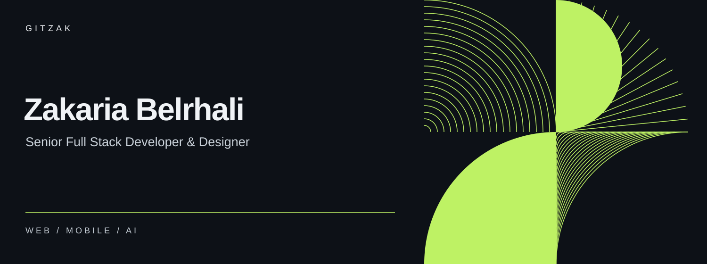

**Web applications · Mobile experiences · AI integrations**

Based in Rabat, Morocco · 8+ years building digital products

---

### About me

I'm a full stack developer and designer who connects product thinking, clean interfaces, and maintainable code. My core stack is **Laravel, React, Next.js, and TypeScript**, with a growing focus on integrating AI into useful applications.

- **At work:** Senior Full Stack Developer at **Dial Technologies**, contributing to backend development, technical decisions, and application improvements.
- **Product experience:** Built **CreaSouk**, a multi-vendor e-commerce SaaS platform with catalog, order, customer, and online payment features.
- **Education:** Computer Engineering & Artificial Intelligence (G2IA), **Université Ibn Tofail · 2025–2026**.
- **Exploring:** AI agents, RAG, MCP, and practical automation — alongside hands-on Arduino projects.
- **Design mindset:** Thoughtful UX, responsive interfaces, and attention to detail.

### Stack & tools

| Area | Technologies |
| :--- | :--- |
| **Frontend** | React · Next.js · Vue.js 3 · TypeScript · JavaScript · Inertia.js |
| **Backend & APIs** | PHP · Laravel · CodeIgniter · Node.js · Express.js · REST APIs |
| **Mobile** | React Native · Expo · Flutter · NativePHP |
| **Data & storage** | PostgreSQL · MySQL · MongoDB · Redis · Firebase · SQL Server |
| **AI integrations** | OpenAI API · Anthropic Claude API · AI SDK · AI agents · RAG · MCP |
| **Data & analytics** | Python · Pandas · NumPy · Power BI |
| **Delivery & design** | Git · Docker · Figma · Photoshop · Illustrator |
| **CMS & commerce** | WordPress · WooCommerce · PrestaShop |

### What I build

**Web & SaaS** — Business applications, dashboards, e-commerce platforms, and APIs.

**Mobile** — Cross-platform experiences with React Native and Expo.

**AI & data** — AI-powered features, workflow automation, and data analysis.

### GitHub activity

Contribution calendar updates daily from GitHub. Language usage reflects repositories, not proficiency.

---

**Have a product in mind? Let's connect.**

[Portfolio](https://zakariabelrhali.com) · [LinkedIn](https://www.linkedin.com/in/zakaria-belrhali/)

Code with purpose. Design with care.

